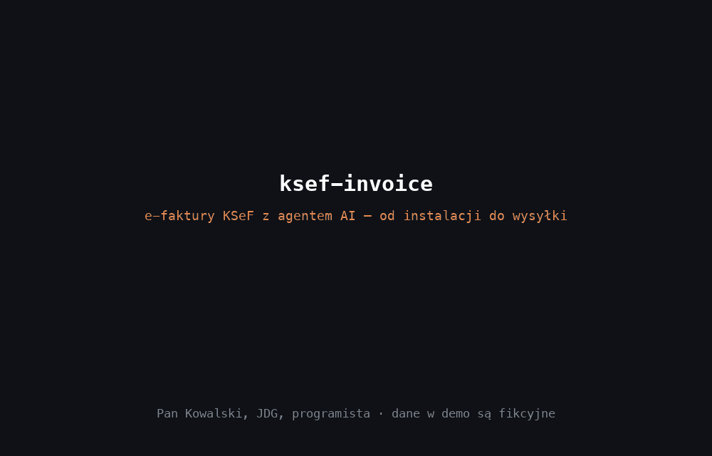

# ksef-invoice - e-faktury KSeF z agentem AI

Skill dla Claude Code, Cursora, Codexa i innych agentów AI. Wystawia, sprawdza, odczytuje i koryguje faktury KSeF w formacie FA(3), w tym faktury zwykłe, korygujące, zaliczkowe, rozliczające oraz korekty zaliczek i rozliczeń. Każdy plik jest sprawdzany na oficjalnym schemacie XSD Ministerstwa Finansów wbudowanym w repozytorium.



*Demo: wyniki skryptu są prawdziwe, dialog z agentem jest odegrany, a dane fikcyjne.*

> Ten plik jest dla ludzi. Agent czyta tylko krótki [`SKILL.md`](SKILL.md), żeby nie zużywać tokenów.

**Spis treści:** [Czym jest KSeF](#czym-jest-ksef-w-30-sekund) . [Co daje skill](#co-daje-ten-skill) . [Instalacja krok po kroku](#instalacja-krok-po-kroku) . [Pierwsza faktura](#pierwsza-faktura---krok-po-kroku) . [Gotowe polecenia](#gotowe-polecenia-do-skopiowania) . [Jak wysłać do KSeF](#jak-wysłać-fakturę-do-ksef) . [Problemy](#gdy-coś-nie-działa) . [Dla zaawansowanych](#dla-zaawansowanych-ręczne-użycie-skryptu)

---

## Czym jest KSeF (w 30 sekund)

**KSeF, czyli Krajowy System e-Faktur**, to państwowa platforma, przez którą przechodzą faktury B2B w Polsce. Faktura nie jest już PDF-em, tylko plikiem **XML** w ściśle określonej strukturze (obecnie **FA(3)**). Wysyłasz go do KSeF, system nadaje mu numer KSeF, a klient odbiera fakturę z systemu.

**Terminy** (stan na listopad 2026 r., aktualne komunikaty znajdziesz na [ksef.podatki.gov.pl](https://ksef.podatki.gov.pl)):

| Kto | Od kiedy |
| :--- | :--- |
| Firmy ze sprzedażą powyżej 200 mln zł w 2024 r. | 1 lutego 2026 |
| Pozostali podatnicy (w tym JDG) | 1 kwietnia 2026 |
| Najmniejsi (sprzedaż do 10 tys. zł miesięcznie) | do końca 2026 r. mogą wystawiać faktury poza KSeF |

Zapowiedziano okres bez kar za błędy w KSeF do końca 2026 r. Źródła różnią się co do 2027 r., więc w razie wątpliwości zapytaj księgowego.

---

## Co daje ten skill

| Twoja sytuacja | Co robi skill |
| :--- | :--- |
| Muszę wystawić e-fakturę i nie chcę płacić za program | Z opisu w zwykłym języku tworzy poprawny plik XML FA(3). |
| Pomyliłem się albo dałem klientowi rabat | Tworzy **fakturę korygującą** (`KOR`) na podstawie pliku XML oryginału (`correct`). |
| Klient płaci zaliczkę | Tworzy **fakturę zaliczkową** (`ZAL`) i sam rozbija wpłatę na stawki VAT. |
| Kończę zlecenie, w którym były zaliczki | Tworzy **fakturę rozliczającą** (`ROZ`), która odejmuje zaliczki i pokazuje kwotę do dopłaty. |
| Muszę skorygować zaliczkę albo fakturę rozliczającą | Tworzy **korektę zaliczki** (`KOR_ZAL`) lub **korektę rozliczenia** (`KOR_ROZ`) z referencjami wymaganymi przez KSeF. |
| Sprzedaję do szkoły, urzędu (JST), grupy VAT lub oddziału | Uzupełnia sekcję **Podmiot3** (odbiorca, rola JST 8 lub grupa VAT 10) i odpowiednie znaczniki w `Podmiot2`. |
| Sprzedaję towary lub usługi z oznaczeniem GTU | Dodaje kody **GTU_01..GTU_13** do pozycji faktury (`FaWiersz/GTU`) lub zamówienia (`ZamowienieWiersz/GTUZ`). |
| KSeF odrzucił moją fakturę albo mam cały folder plików | Sprawdza pojedynczy plik, katalog lub glob na lokalnym XSD, wypisuje podsumowanie JSON i opcjonalny raport CSV (`--csv`). |
| Mam 40 faktur kosztowych z KSeF w XML | Zamienia je na zestawienie w Excelu (razem ze skillami `invoice-processing` i `xlsx-toolkit`). |

**Czego skill nie robi (celowo):**

- **Nie wysyła niczego do KSeF** i nigdy nie prosi o Twój token, certyfikat ani logowanie. Plik XML wysyłasz sam (patrz [Jak wysłać fakturę do KSeF](#jak-wysłać-fakturę-do-ksef)).
- **Nie decyduje o podatkach.** Stawkę VAT, podstawę zwolnienia, odwrotne obciążenie, kody GTU i datę ujęcia korekty wybierasz Ty albo Twój księgowy. Skill może jedynie zwrócić uwagę na wątpliwości.
- **Nie obsługuje:** procedury marży, wewnątrzwspólnotowej dostawy nowych środków transportu i załączników.

---

## Instalacja krok po kroku

### Krok 1. Potrzebujesz agenta AI

Wystarczy jeden z nich:
- **Claude Code**: w aplikacji Claude na komputerze (zakładka **Code**) albo w terminalu (`claude`),
- **Cursor**, **Codex** albo inny agent obsługujący *Agent Skills*.

### Krok 2. Zainstaluj skille

Otwórz **Terminal** i wklej:

```bash
npx skills add PawelBednarekPunks/aidevbird-skills
```

Instalator zapyta, dla których agentów zainstalować skille. Wybierz swojego (np. Claude Code).

Jeśli nie masz `npx` (Node.js), użyj drugiego sposobu:

```bash
git clone https://github.com/PawelBednarekPunks/aidevbird-skills.git
```

```bash
cd aidevbird-skills && ./scripts/install.sh --global
```

### Krok 3. Załóż folder na faktury

```bash
mkdir -p ~/Faktury && cd ~/Faktury
```

W tym folderze agent będzie trzymał dane Twojej firmy (`ksef-firma.json`) i wszystkie pliki XML. Dzięki temu sam zaproponuje kolejny numer faktury.

### Krok 4. Uruchom agenta w tym folderze

- **Claude Code w terminalu:** w folderze `~/Faktury` wpisz `claude`.
- **Aplikacja Claude, zakładka Code:** wybierz folder `~/Faktury` jako folder projektu.
- **Cursor:** *File -> Open Folder* i wybierz `~/Faktury`.

Przy pierwszej fakturze agent może poprosić o zgodę na instalację biblioteki `lxml` (potrzebnej do walidacji XML). Schemat XSD FA(3) jest wbudowany w repozytorium, więc walidacja działa bez dostępu do internetu.

---

## Pierwsza faktura - krok po kroku

**1. Napisz do agenta, na przykład:**

> Wystaw fakturę KSeF dla Acme sp. z o.o., NIP 9876540016, ul. Długa 5, 30-001 Kraków, za 160 godzin programowania po 150 zł netto, VAT 23%, płatność 14 dni.

**2. Agent zapyta o dane Twojej firmy** (tylko za pierwszym razem): nazwę, NIP, adres i numer konta. Zaproponuje też zapisanie ich w `ksef-firma.json`. Zgódź się, a przy kolejnych fakturach nie będzie już o nie pytał. Plik wygląda tak:

```json
{
  "seller": {
    "name": "Jan Kowalski Software",
    "tax_id": "1234560007",
    "address": { "line1": "ul. Prosta 1/2", "line2": "00-001 Warszawa" },
    "email": "jan@example.com"
  },
  "iban": "PL61 1090 1014 0000 0712 1981 2874"
}
```

**3. Agent zaproponuje numer faktury** (np. `FV/1/11/2026`) i poprosi o potwierdzenie.

**4. Dostajesz podsumowanie i plik**, na przykład:

```text
Faktura VAT FV/1/11/2026 - Acme sp. z o.o.
23%: netto 24 000,00 zł, VAT 5 520,00 zł
Razem brutto: 29 520,00 zł
Plik: ~/Faktury/FV-1-11-2026.xml (zgodny ze schematem FA(3))
Następny krok: wyślij plik w Aplikacji Podatnika KSeF lub w programie księgowym.
```

**5. Wysyłasz plik do KSeF.** Po przyjęciu faktury KSeF nada jej **numer KSeF**. Zapisz go, bo przyda się przy ewentualnej korekcie albo rozliczeniu zaliczki.

---

## Gotowe polecenia do skopiowania

Skill uruchamia się sam, gdy w wiadomości pojawi się coś o **KSeF, e-fakturze, fakturze XML, FA(3), korekcie albo zaliczce**. Jeśli agent go nie użyje, dopisz na początku: **Użyj skilla ksef-invoice.** W Claude Code możesz też wpisać po prostu `/ksef-invoice`.

### Zwykła faktura

> Wystaw fakturę KSeF dla Acme sp. z o.o. (NIP 9876540016) za hosting w listopadzie: 99,99 zł netto, VAT 23%.

> Wystaw fakturę KSeF dla Example GmbH z Niemiec (VAT DE123456789) na 5000 EUR za usługi programistyczne. To usługa niepodlegająca opodatkowaniu w Polsce (np II).

> Wystaw fakturę dla osoby prywatnej: Anna Nowak, ul. Polna 3, 00-002 Warszawa, strona WWW za 2000 zł netto, VAT 23%.

> Wystaw fakturę ze zwolnieniem z VAT (zwolnienie podmiotowe, art. 113 ust. 1) dla Acme na 1000 zł za konsultację.

### Korekta

> Zrób korektę faktury FV-1-11-2026.xml: zamiast 160 godzin powinno być 150. Numer KSeF oryginału: 1234560007-20261108-0A1B2C-3D4E5F-A1.

> Wystaw korektę do zera dla faktury FV-7-10-2026.xml, bo klient zrezygnował. Oryginał był wystawiony poza KSeF.

> Klient dostał 10% rabatu od faktury FV-3-11-2026.xml. Zrób korektę.

Najprościej trzymać oryginał w tym samym folderze. Polecenie `correct` odczyta z niego pozycje przed korektą i nałoży zmiany. Na korekcie zmniejszającej kwoty są ujemne.

### Zaliczka, rozliczenie oraz ich korekty

> Klient Acme wpłacił 5000 zł zaliczki 5 listopada na zamówienie: aplikacja mobilna 10 000 zł netto (VAT 23%) i 2 szkolenia po 500 zł netto (VAT 8%). Wystaw fakturę zaliczkową.

> Skończyłem zlecenie dla Acme. Wystaw fakturę rozliczającą do zaliczki FZ-1-11-2026.xml (numer KSeF zaliczki: 1234560007-20261105-ABCDEF-123456-0F).

> Klientowi zwróciłem część zaliczki z FZ-1-11-2026.xml. Wystaw korektę faktury zaliczkowej (KOR_ZAL).

> Po wystawieniu faktury rozliczającej FV-5-12-2026.xml przyznaliśmy rabat na szkolenie. Wystaw korektę faktury rozliczającej (KOR_ROZ).

### Sprawdzanie i zestawienia

> KSeF odrzucił plik faktura.xml. Sprawdź, co jest nie tak, i popraw.

> Sprawdź wszystkie pliki XML w tym folderze i zapisz raport błędów do CSV.

> Zrób zestawienie w Excelu z faktur kosztowych w folderze ksef-pobrane/: numer, sprzedawca, NIP, netto, VAT, brutto, termin płatności.

---

## Jak wysłać fakturę do KSeF

Skill przygotowuje plik, a wysyłasz go Ty. Masz trzy możliwości:

1. **Bezpłatna aplikacja Ministerstwa Finansów** (Aplikacja Podatnika KSeF): logujesz się, wybierasz wysyłkę faktury z pliku i wskazujesz plik `.xml`. Szczegóły znajdziesz na [ksef.podatki.gov.pl](https://ksef.podatki.gov.pl).
2. **Twój program księgowy albo bank**, jeśli umożliwia import XML FA(3).
3. **Biuro rachunkowe**: wysyłasz im plik, a oni go przekazują.

Najpierw możesz przetestować wysyłkę w **środowisku testowym KSeF**, które MF udostępnia bezpłatnie. Faktury wysłane tam nie mają skutków podatkowych.

---

## Gdy coś nie działa

| Problem | Rozwiązanie |
| :--- | :--- |
| Agent nie używa skilla | Zacznij wiadomość od "Użyj skilla ksef-invoice" albo wpisz `/ksef-invoice`. Sprawdź, czy instalacja się powiodła: `ls ~/.claude/skills`. |
| `Brak biblioteki lxml` | Pozwól agentowi zainstalować bibliotekę albo wpisz `python3 -m pip install --user lxml`. |
| `Nie można wczytać schematu XSD FA(3)` | Sprawdź obecność katalogu `skills/ksef-invoice/xsd/1-0E` lub zmienną środowiskową `KSEF_SCHEMA_DIR`. |
| `Nieprawidłowa suma kontrolna NIP ...` | W NIP-ie jest literówka. Sprawdź go w wykazie podatników VAT (biała lista). |
| `Błąd XSD (linia ...)` | Niedozwolona wartość lub kolejność pól, np. stawka 24% albo zły kod waluty. Komunikat wskaże linię i pole. |
| `Pole P_13_x ... nie zgadza się z sumą pozycji` | Suma nie zgadza się z pozycjami, czyli faktura była edytowana ręcznie. Przebuduj plik poleceniem `build`. |
| `Oryginał nie ma numeru KSeF` | Polecenie `correct` wymaga numeru KSeF oryginału (`ksef_number` w pliku zmian). Dla faktur spoza KSeF użyj `build` z `type: "correction"`. |

---

## Dla zaawansowanych: ręczne użycie skryptu

Skrypt działa też bez agenta. Po instalacji przez `install.sh --global` jest w `~/.agents/skills/ksef-invoice`:

```bash
cd ~/.agents/skills/ksef-invoice
```

```bash
python3 scripts/ksef_fa3.py build examples/invoice.json ~/Faktury/test.xml
```

```bash
python3 scripts/ksef_fa3.py validate ~/Faktury/ --csv ~/Faktury/raport.csv
```

```bash
python3 scripts/ksef_fa3.py read ~/Faktury/test.xml
```

```bash
python3 scripts/ksef_fa3.py correct examples/invoice.xml zmiany.json ~/Faktury/korekta.xml
```

Każde polecenie wypisuje jedną linię JSON. Kod wyjścia `0` oznacza, że wszystko jest w porządku, `1` że faktura ma błędy (lista w `issues`), a `2` błąd uruchomienia (brak pliku albo `lxml`).

Polecenie `validate` przyjmuje pojedynczy plik, katalog albo wzorzec glob i zwraca:
`{"files":[{"file":"...","status":"ok","issues":[]}],"summary":{"ok":1,"issues":0}}`.

### Przykładowe pliki

| Plik | Co pokazuje |
| :--- | :--- |
| [`examples/invoice.json`](examples/invoice.json) | Zwykła faktura VAT (`VAT`) |
| [`examples/correction.json`](examples/correction.json) | Korekta zwykłej faktury (`KOR`), oryginał w KSeF |
| [`examples/advance.json`](examples/advance.json) | Zaliczka 5000 zł na zamówienie z dwiema stawkami VAT (`ZAL`) |
| [`examples/final.json`](examples/final.json) | Rozliczenie zamówienia po zaliczce (`ROZ`) |
| [`examples/kor_zal.json`](examples/kor_zal.json) | Korekta faktury zaliczkowej (`KOR_ZAL`) |
| [`examples/kor_roz.json`](examples/kor_roz.json) | Korekta faktury rozliczającej (`KOR_ROZ`) |

Obok każdego pliku JSON leży wygenerowany z niego XML.

### Pola wspólne

| Pole | Wymagane | Opis | Pole w FA(3) |
| :--- | :--- | :--- | :--- |
| `type` | nie | `invoice` (domyślnie), `correction`, `advance`, `final`, `kor_zal`, `kor_roz` | `RodzajFaktury` VAT / KOR / ZAL / ROZ / KOR_ZAL / KOR_ROZ |
| `number` | tak | Numer faktury | `P_2` |
| `issue_date` | tak | Data wystawienia `RRRR-MM-DD` | `P_1` |
| `sale_date` | nie | Data sprzedaży, jeśli inna niż data wystawienia | `P_6` |
| `place` | nie | Miejsce wystawienia | `P_1M` |
| `currency`, `fx_rate` | nie | Waluta (domyślnie PLN) i kurs PLN, gdy jest VAT w walucie obcej | `KodWaluty`, `P_14_xW` |
| `seller` | tak | `name`, `tax_id` (NIP), `address.line1` (ulica), `address.line2` (kod i miasto) | `Podmiot1` |
| `buyer` | tak | `name`, `tax_id`, `country`, `address` | `Podmiot2` |
| `podmiot3` (lub `recipient`) | nie | Odbiorca inny niż nabywca: `name`, `tax_id` lub `id_wew`, `address`, `role` (`odbiorca`=2, `jst`=8, `gv`=10 lub 1..11) | `Podmiot3`, `Podmiot2/JST`, `Podmiot2/GV` |
| `lines[]` | zależy od typu | `description`, `qty`, `unit`, `unit_net` (lub `net`), `vat_rate`, opcjonalnie `gtu` (`GTU_01`..`GTU_13`) | `FaWiersz`, `FaWiersz/GTU` |
| `due_date`, `iban` | nie | Termin płatności i numer konta | `Platnosc` |
| `exemption_basis` | przy `zw` | Podstawa zwolnienia | `P_19A` |
| `split_payment`, `cash_method`, `self_billing` | nie | `true`: podzielona płatność / metoda kasowa / samofakturowanie | `P_18A`, `P_16`, `P_17` |

### Pola dla korekt (`type: "correction" | "kor_zal" | "kor_roz"`)

| Pole | Opis | Pole w FA(3) |
| :--- | :--- | :--- |
| `corrects.number`, `corrects.issue_date` | Numer i data faktury korygowanej | `DaneFaKorygowanej` |
| `corrects.ksef_number` | Numer KSeF oryginału. Bez niego faktura jest oznaczona jako wystawiona poza KSeF | `NrKSeFFaKorygowanej` / `NrKSeFN` |
| `lines_before` | Pozycje z oryginału (stan przed korektą) | `FaWiersz` + `StanPrzed` |
| `lines` | Pozycje po korekcie; `[]` oznacza korektę do zera | `FaWiersz` |
| `reason` | Przyczyna korekty | `PrzyczynaKorekty` |
| `correction_effect` | 1: w dacie faktury pierwotnej, 2: w dacie korekty (domyślnie), 3: inna | `TypKorekty` |
| `advances[]` (wymagane dla `kor_roz`) | Referencje do zaliczek (`number` lub `ksef_number`) | `FakturaZaliczkowa` |

Sumy (`P_13_x`, `P_14_x`, `P_15`) to **różnica**: stan po korekcie minus stan przed.

### Pola dla zaliczki (`type: "advance"`)

| Pole | Opis | Pole w FA(3) |
| :--- | :--- | :--- |
| `order_lines` | Całe zamówienie albo umowa (opcjonalnie z `gtu`) | `Zamowienie/ZamowienieWiersz` (`GTUZ`) |
| `paid` | Otrzymana kwota brutto | `P_15` |
| `paid_date` | Data otrzymania zapłaty | `P_6`, `Platnosc/DataZaplaty` |

VAT liczony jest od kwoty brutto: kwota * stawka / (100 + stawka), zgodnie z art. 106f ust. 1 pkt 3 ustawy o VAT. Przy kilku stawkach wpłata dzielona jest proporcjonalnie do wartości brutto zamówienia w każdej stawce.

### Pola dla rozliczenia (`type: "final"`)

| Pole | Opis | Pole w FA(3) |
| :--- | :--- | :--- |
| `lines` | Całe zamówienie | `FaWiersz` |
| `advances[]` | `number`, `ksef_number` i `by_rate` każdej zaliczki. `by_rate` daje polecenie `read` na pliku zaliczki | `FakturaZaliczkowa` |

Sumy to wartość zamówienia **pomniejszona o zaliczki**, a `P_15` to kwota pozostała do zapłaty.

### Nabywca i Podmiot3

| Kto kupuje / odbiera | Co podać | Co trafia do XML |
| :--- | :--- | :--- |
| Polska firma | `tax_id` = NIP | `NIP` |
| Firma z UE | `country` (np. `DE`) i `tax_id` = numer VAT UE | `KodUE` + `NrVatUE` |
| Firma spoza UE | `country` i `tax_id` | `KodKraju` + `NrID` |
| Osoba prywatna | bez `tax_id` | `BrakID` |
| Jednostka podrzędna JST | w `podmiot3`: `role: "jst"` (8), `tax_id` (NIP) lub `id_wew` | `Podmiot2/JST=1` + `Podmiot3` (`Rola=8`) |
| Członek grupy VAT | w `podmiot3`: `role: "gv"` (10), `tax_id` (NIP) lub `id_wew` | `Podmiot2/GV=1` + `Podmiot3` (`Rola=10`) |

### Stawki VAT (`vat_rate`)

| Wartość | Znaczenie | Suma netto / VAT |
| :--- | :--- | :--- |
| `23` (albo `22`) | stawka podstawowa | `P_13_1` / `P_14_1` |
| `8` (albo `7`) | stawka obniżona | `P_13_2` / `P_14_2` |
| `5` | stawka obniżona | `P_13_3` / `P_14_3` |
| `0 KR` / `0 WDT` / `0 EX` | 0%: w kraju / WDT / eksport | `P_13_6_1` / `_2` / `_3` |
| `zw` | zwolnione (wymaga `exemption_basis`) | `P_13_7` |
| `np I` | niepodlegające opodatkowaniu - poza krajem | `P_13_8` |
| `np II` | usługi z art. 100 ust. 1 pkt 4 (np. usługi dla firm z UE) | `P_13_9` |
| `oo` | odwrotne obciążenie | `P_13_10` |

VAT liczony jest od **sumy netto w danej stawce** i zaokrąglany do grosza.

### Co sprawdza walidacja

1. **Oficjalny XSD FA(3) (`xsd/1-0E/`)**: struktura, kolejność i wymagalność pól, dozwolone wartości, formaty dat, kwot, NIP, IDWew, GTU i numeru KSeF.
2. **Sumy**: pozycje (dla korekt `KOR`, `KOR_ZAL`, `KOR_ROZ`: stan po minus stan przed) muszą zgadzać się z `P_13_x`.
3. **VAT**: `P_14_x` = stawka * netto; dla zaliczki VAT liczony jest od brutto.
4. **Należność**: `P_15` = suma `P_13_x` i `P_14_x`.
5. **Spójność referencji**: `KOR`, `KOR_ZAL` i `KOR_ROZ` muszą zawierać `DaneFaKorygowanej`, `ROZ` i `KOR_ROZ` muszą zawierać `FakturaZaliczkowa`, a `ZAL` musi zawierać `Zamowienie` o wartości nie mniejszej niż `P_15`.
6. **NIP**: suma kontrolna NIP sprzedawcy, nabywcy oraz odbiorcy w `Podmiot3`.

**Uwaga:** zgodność z XSD nie gwarantuje poprawności podatkowej, np. tego, że wybrałeś właściwą stawkę.

---

## Źródła

- [Broszura informacyjna MF dotycząca struktury logicznej FA(3)](https://ksef.podatki.gov.pl/media/jknpcymf/broszura-informacyjna-dotyczaca-struktury-logicznej-fa-3-04032026.pdf)
- [Information sheet on the FA(3) logical structure (EN)](https://ksef.podatki.gov.pl/media/4u1bmhx4/information-sheet-on-the-fa-3-logical-structure.pdf)
- Schemat XSD: `http://crd.gov.pl/wzor/2025/06/25/13775/schemat.xsd`
- [Portal KSeF - podatki.gov.pl](https://ksef.podatki.gov.pl)

---

Część kolekcji **[AiDevBird Skills](../../README.md)**. Masz pomysł albo znalazłeś błąd? Otwórz issue.
